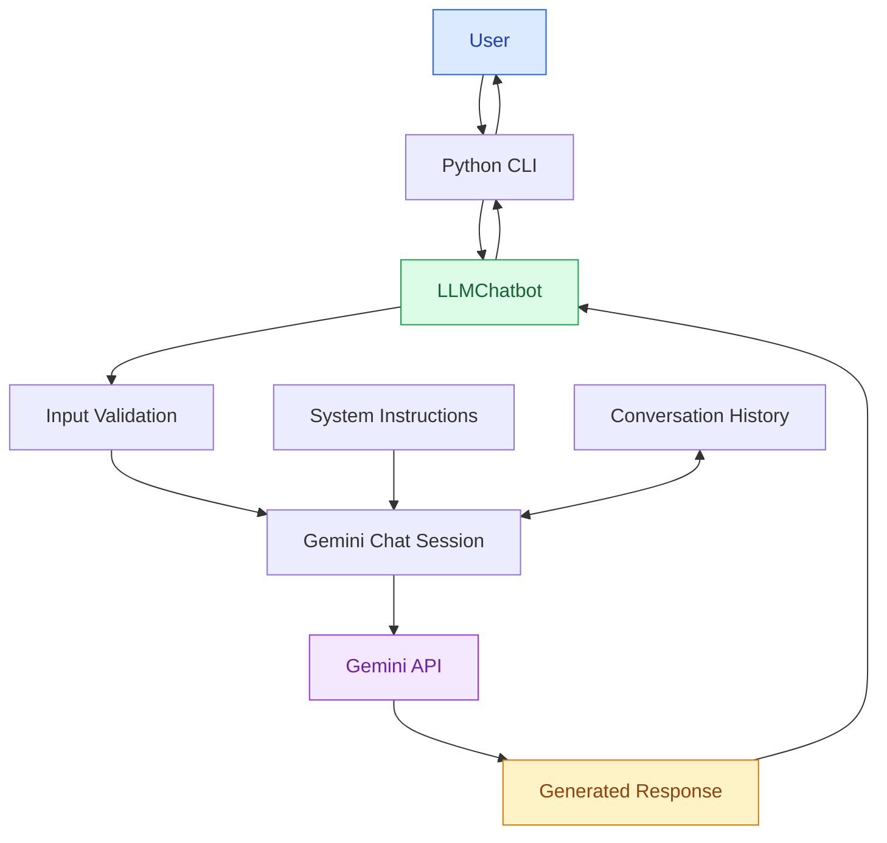
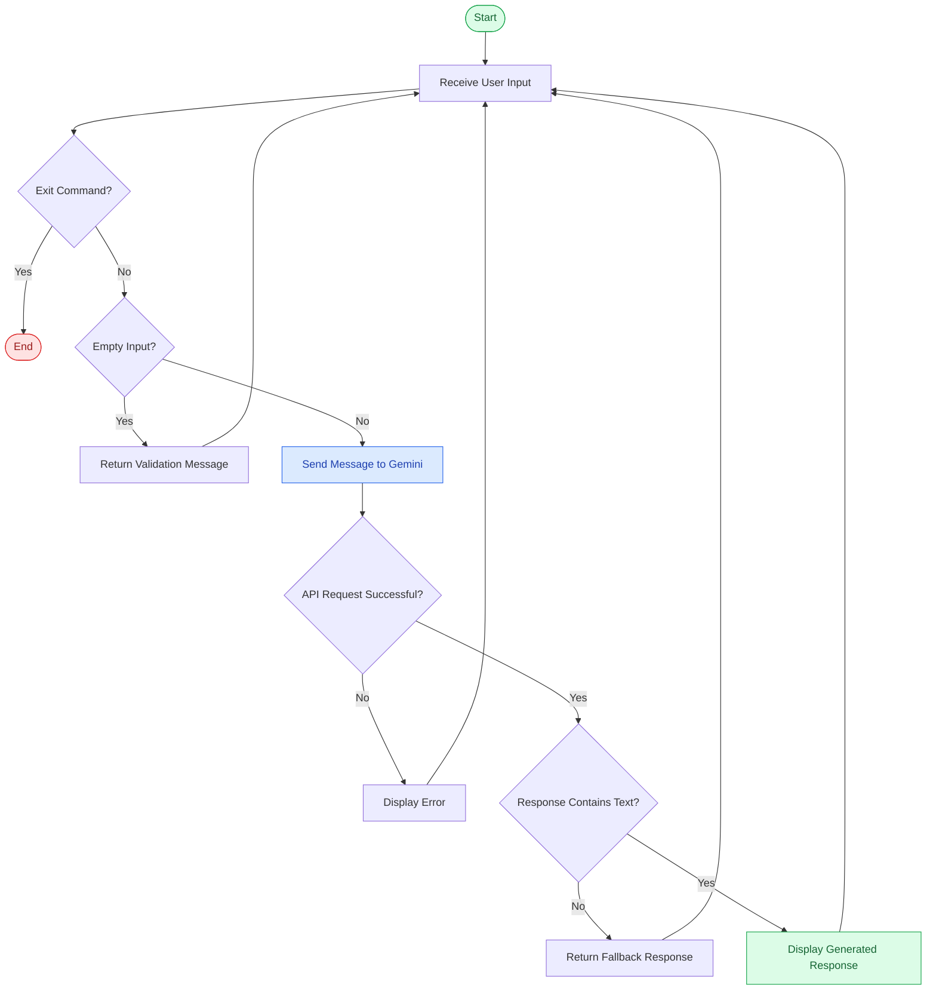
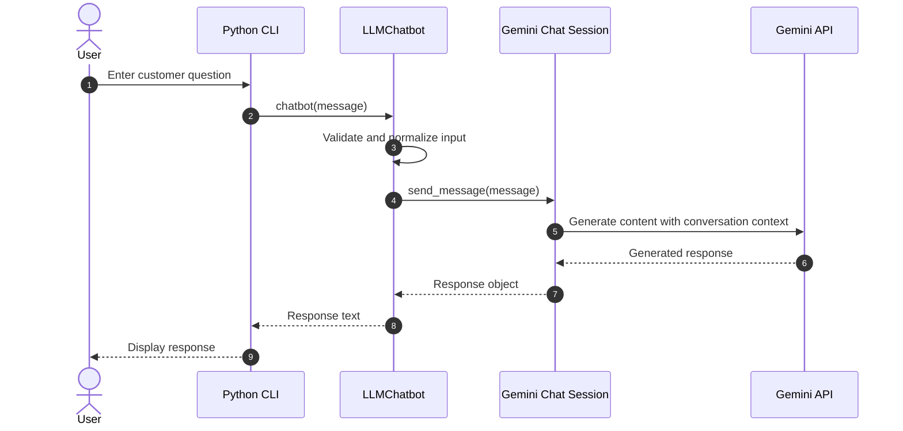
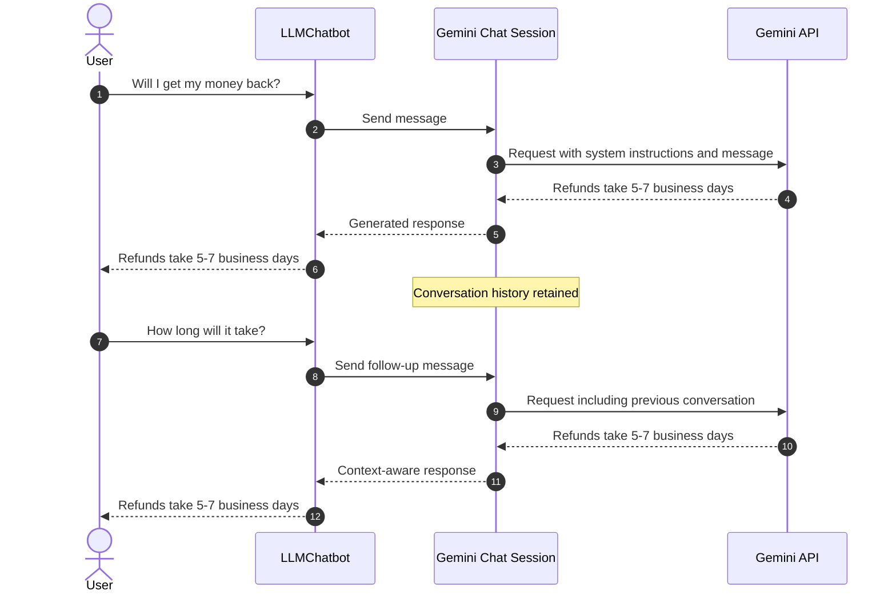
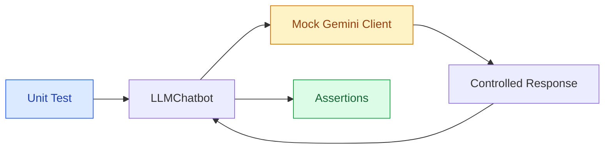
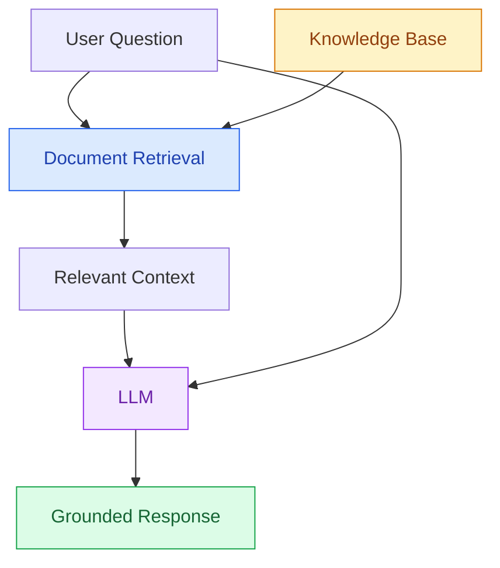

# Level 4: LLM-Powered Customer Support Chatbot

## Overview

This project implements an **LLM-powered customer support chatbot** using Python and Google's Gemini API.

Unlike previous chatbot implementations that rely on predefined rules, keyword matching, or intent classification, this chatbot uses a pretrained Large Language Model (LLM) to generate natural-language responses dynamically.

The chatbot supports multi-turn conversations, maintains conversation context, and follows predefined customer support policies through system instructions.

This is the fourth level of the [Chatbot Levels](../README.md) project, which explores the evolution of chatbot technologies from simple conditional logic to AI-powered systems.

## Features

- Natural-language response generation
- Google Gemini API integration
- Multi-turn conversation support
- Conversation history management
- System instructions for customer support
- Input validation
- Fallback handling for empty model responses
- Environment-based API key management
- Automated unit testing with mocked API responses
- Interactive command-line interface

## System Architecture

The chatbot uses a client-server architecture in which a Python application communicates with Google's Gemini API.



### Architecture Components

| Component | Responsibility |
|---|---|
| User | Sends customer support requests |
| Python CLI | Handles terminal interaction |
| LLMChatbot | Validates input and manages the chatbot |
| Gemini Chat Session | Manages conversational interactions |
| Gemini API | Generates natural-language responses |
| System Instructions | Defines chatbot behavior and store policies |
| Conversation History | Provides context from previous messages |

The Python application manages user interaction, while the Gemini API performs language generation.

The Gemini SDK maintains conversation history within a chat session and supplies relevant history to subsequent API requests.

---

## Technologies Used

| Technology | Purpose |
|---|---|
| Python | Main programming language |
| Google Gemini | Large Language Model |
| google-genai | Official Gemini Python SDK |
| python-dotenv | Environment variable management |
| unittest | Automated unit testing |
| unittest.mock | Simulated Gemini API interactions |
| Git | Version control |
| GitHub | Source code management |

### LLM Model

The implementation uses:

```python
MODEL_NAME = "gemini-3.5-flash-lite"
```

The model is accessed through the Gemini API.

Model availability, pricing, and rate limits depend on the Google AI project and account configuration.

---

## How It Works

The chatbot processes messages through a series of steps.

1. Receive user input.
2. Check whether the user wants to exit.
3. Validate the message.
4. Send the message through the Gemini chat session.
5. Generate a response using the LLM.
6. Extract the generated text.
7. Display the response.
8. Continue the conversation.

### Request Processing Flowchart



### Input Validation

The chatbot removes surrounding whitespace:

```python
message = message.strip()
```

If the message is empty, it returns:

```python
return "Please enter a message."
```

Empty messages are not sent to the Gemini API.

### Response Generation

For valid input, the chatbot sends the message through its chat session:

```python
response = self.chat.send_message(message)
```

The generated response is extracted using:

```python
return response.text or "Sorry, I couldn't generate a response."
```

If Gemini returns no text, the chatbot provides a fallback response.

API exceptions are handled by the command-line interface, which displays the error and allows the user to continue.

---

## Gemini API Integration

The chatbot uses Google's official Python SDK.

### Importing Dependencies

```python
import os
from pathlib import Path

from dotenv import load_dotenv
from google import genai
from google.genai import types
```

### Loading Environment Variables

```python
BASE_DIR = Path(__file__).resolve().parent.parent

load_dotenv(BASE_DIR / ".env")
```

This loads the environment configuration from the repository's root directory.

### Initializing the Gemini Client

```python
api_key = os.getenv("GEMINI_API_KEY")

client = genai.Client(api_key=api_key)
```

The API key is read from an environment variable rather than hardcoded into the source code.

### Creating a Chat Session

```python
self.chat = self.client.chats.create(
    model=MODEL_NAME,
    config=types.GenerateContentConfig(
        system_instruction=SYSTEM_PROMPT,
        temperature=0.3,
        max_output_tokens=500,
    ),
)
```

### Generation Configuration

| Parameter | Value | Purpose |
|---|---|---|
| `model` | Gemini Flash-Lite | Selects the language model |
| `system_instruction` | Customer support instructions | Defines assistant behavior |
| `temperature` | 0.3 | Configures generation randomness |
| `max_output_tokens` | 500 | Limits generated output tokens |

A relatively low temperature is used to encourage more consistent customer support responses.

However, temperature does not guarantee deterministic or factually correct output.

### API Interaction Sequence



The `LLMChatbot` class separates application logic from the external API client.

This design makes testing easier because the real Gemini client can be replaced with a mock.

---

## System Instructions

The chatbot operates as a customer support assistant for a fictional online store.

Its system instructions define the following policies:

| Category | Policy |
|---|---|
| Shipping | Standard shipping takes 3–5 business days |
| Returns | Products can be returned within 30 days |
| Refunds | Refund processing takes 5–7 business days |
| Order Tracking | Customers can track orders through their accounts |
| Human Support | support@example.com |

The instructions also direct the chatbot to:

- Respond politely and clearly.
- Keep responses concise.
- Use the provided store policies.
- Avoid inventing order statuses or refund approvals.
- Refer unsupported requests to human support.

These instructions guide the LLM's behavior but do not guarantee that every generated response will comply perfectly.

All store information in this project is fictional.

---

## Conversation Memory

One of the main improvements introduced in Level 4 is support for multi-turn conversations.

Previous chatbot implementations processed messages independently.

Level 4 maintains a chat session that provides conversational context.

### Example

```text
You: Will I get my money back?

Bot: Yes, refunds are processed within 5-7 business days.

You: How long will it take?

Bot: Refunds are processed within 5-7 business days.
```

The second question does not explicitly mention refunds.

However, the chatbot can use the earlier conversation to interpret the follow-up question.

### Conversation Memory Diagram



### How Conversation History Works

The Gemini chat session manages previous messages and includes them in subsequent model requests.

This allows the model to reference earlier conversation turns.

However, the current implementation does not provide persistent memory.

Conversation history is maintained within the active chatbot session and is not saved to a database.

Restarting the application starts a new conversation.

---

## Project Structure

```text
chatbot-levels/
│
├── .env.example
├── .gitignore
├── requirements.txt
│
├── 01-rule-based/
├── 02-keyword-matching/
├── 03-intent-based/
│
└── 04-llm/
    ├── bot.py
    ├── test_bot.py
    └── README.md
```

### File Descriptions

**bot.py**

Contains the Gemini chatbot implementation.

Main components:

- `LLMChatbot`: Manages the Gemini client and chat session.
- `chatbot(message)`: Validates input and generates responses.
- `main()`: Runs the interactive command-line interface.

**test_bot.py**

Contains automated tests using `unittest` and `unittest.mock`.

**README.md**

Documents the architecture, implementation, testing, and limitations.

**requirements.txt**

Defines the project's Python dependencies.

**.env.example**

Provides an example environment variable configuration without exposing real credentials.

---

## Installation

### Prerequisites

- Python 3.10 or later
- Internet connection
- Google Gemini API key
- Git

### 1. Clone the Repository

```bash
git clone https://github.com/qrtman/chatbot-levels.git
```

Navigate to the project:

```bash
cd chatbot-levels
```

### 2. Switch to the Level 4 Branch

```bash
git fetch origin
git switch feature/level-4-llm
```

If the branch does not exist locally yet:

```bash
git switch --track origin/feature/level-4-llm
```

### 3. Create a Virtual Environment

```bash
python -m venv .venv
```

Activate it on macOS or Linux:

```bash
source .venv/bin/activate
```

On Windows:

```powershell
.venv\Scripts\Activate.ps1
```

### 4. Install Dependencies

From the repository root:

```bash
python -m pip install -r requirements.txt
```

The Level 4 dependencies include:

```text
google-genai
python-dotenv
```

The root requirements file also contains dependencies used by previous chatbot levels.

---

## Environment Configuration

### 1. Obtain an API Key

Create a Gemini API key using Google AI Studio:

https://aistudio.google.com/apikey

### 2. Configure Environment Variables

Create a `.env` file in the repository's root directory.

```dotenv
GEMINI_API_KEY=your_actual_api_key
```

The `.env.example` file documents the expected configuration:

```dotenv
GEMINI_API_KEY=your_api_key_here
```

### 3. Protect Your API Key

Never commit real API credentials.

The repository's `.gitignore` excludes environment files.

Verify that the root `.env` file is ignored:

```bash
git check-ignore .env
```

Expected output:

```text
.env
```

The API key should never be included directly in Python source files or committed to GitHub.

---

## Running the Chatbot

From the repository root:

```bash
python 04-llm/bot.py
```

Alternatively:

```bash
cd 04-llm
python bot.py
```

### Example Conversation

The following conversation was observed during manual testing:

```text
LLM Customer Support Chatbot
Model: gemini-3.5-flash-lite
Type 'exit' to quit.

You: hi
Bot: Hello! Welcome to our store. How can I help you today?

You: when will my ordeer arrive??
Bot: Standard shipping takes 3-5 business days. You can track your order through your account!

You: what about returns>??
Bot: Products can be returned within 30 days. Let me know if you need help with anything else!

You: will I get my money back?
Bot: Yes, refunds are processed within 5-7 business days. If you have any further questions, feel free to ask!

You: how long will it take?
Bot: Refunds are processed within 5-7 business days.

You: exit
Bot: Goodbye!
```

The chatbot successfully handled informal wording, misspellings, and a contextual follow-up in this conversation.

Generated responses may vary between executions.

---

## Automated Testing

The project uses Python's built-in `unittest` framework.

Because Level 4 depends on an external API, its automated tests use **mock objects** to simulate Gemini responses.

This allows the application logic to be tested without making actual API requests.

### Why Mocking?

Real API calls introduce several testing challenges:

- Network dependency
- API usage costs
- Rate limits
- Variable response content
- External service availability

Mocking eliminates these dependencies for unit tests.

### Testing Architecture



### Run Tests

From the `04-llm` directory:

```bash
python -m unittest discover -v
```

Or from the repository root:

```bash
python -m unittest discover -s 04-llm -v
```

### Test Coverage

| Test | Description |
|---|---|
| `test_chat_session_created` | Verifies chat session initialization |
| `test_correct_model` | Verifies model configuration |
| `test_system_prompt` | Verifies system instructions |
| `test_valid_message` | Checks successful response handling |
| `test_message_sent_to_gemini` | Verifies API message forwarding |
| `test_empty_input` | Checks empty input handling |
| `test_whitespace_input` | Checks whitespace-only input |
| `test_input_normalization` | Verifies surrounding whitespace removal |
| `test_empty_model_response` | Verifies fallback behavior |
| `test_multiple_messages` | Verifies reuse of the chat session |
| `test_missing_api_key` | Checks missing API key handling |
| `test_api_error_propagates` | Verifies exception propagation |

### Test Results

All 12 automated tests passed during local execution.

```text
----------------------------------------------------------------------
Ran 12 tests in 0.018s

OK
```

**Result: 12 tests passed, 0 failures, 0 errors.**

These tests verify the Python application and mocked Gemini integration.

They do not evaluate actual LLM response quality, policy compliance, or service reliability.

---

## Comparison With Previous Chatbot Levels

| Feature | Level 1: Rule-Based | Level 2: Keyword-Based | Level 3: Intent-Based | Level 4: LLM |
|---|---|---|---|---|
| Exact string matching | Yes | No | No | No |
| Keyword detection | No | Yes | Learned text features | Not explicitly required |
| Machine learning | No | No | Yes | Yes |
| Custom model training | No | No | Yes | No |
| Pretrained language model | No | No | No | Yes |
| Dynamic response generation | No | No | No | Yes |
| Conversation history | No | No | No | Yes |
| External API | No | No | No | Yes |
| Confidence threshold | No | No | Yes | Not implemented |
| Predefined responses | Yes | Yes | Yes | No fixed response mapping |

### Level 1: Rule-Based

Uses exact string matching.

```python
if message == "refund policy":
    return "Refunds are processed within 5–7 business days."
```

Only predefined phrases are recognized.

### Level 2: Keyword-Based

Uses substring matching.

```python
if "refund" in message:
    responses.append("Refunds are processed within 5–7 business days.")
```

Recognizes relevant keywords within longer messages.

### Level 3: Intent-Based

Uses TF-IDF and Logistic Regression to classify user messages.

```text
User Message
    |
    v
TF-IDF
    |
    v
Intent Classification
    |
    v
Predefined Response
```

The model learns relationships between training examples and intent categories.

### Level 4: LLM-Powered

Uses a pretrained language model to generate responses.

```text
User Message
    |
    v
Conversation Context
    |
    v
Gemini API
    |
    v
Generated Response
```

The chatbot can handle more varied language and maintain conversational context.

---

## Limitations

### 1. External API Dependency

The chatbot requires an internet connection and access to the Gemini API.

Network failures, service outages, or API rate limits can interrupt operation.

### 2. Potential API Costs

Gemini API usage may incur charges depending on the selected model, account configuration, and billing tier.

Users should monitor their usage and applicable rate limits.

### 3. Hallucinations

Large language models can generate inaccurate or unsupported information.

Although system instructions restrict the chatbot to fictional store policies, they cannot guarantee perfect compliance.

### 4. No Real Order Database

The chatbot does not connect to an order management system.

It cannot retrieve real order statuses, process refunds, or modify customer accounts.

### 5. Temporary Conversation Memory

Conversation history exists only within the active chat session.

Restarting the application resets the conversation.

### 6. No Persistent Storage

The project does not use a database.

Customer conversations are not saved or retrieved across application restarts.

### 7. No Streaming Output

The current implementation waits for the model response before displaying it.

It does not stream generated tokens to the terminal.

### 8. No Response Quality Evaluation

Automated tests verify application behavior using mocked responses.

The project does not currently evaluate LLM accuracy, hallucination rates, or policy compliance across a benchmark dataset.

---

## Potential Improvements

Future development could include:

- Persistent conversation history
- Response streaming
- API retry handling
- Usage and token tracking
- Structured logging
- Model comparison
- More comprehensive response evaluation
- Web-based chat interface
- Integration with external knowledge sources
- Retrieval-Augmented Generation (RAG)

The next level of the project introduces RAG to support responses grounded in retrieved documents.

---

## Key Concepts Learned

This implementation demonstrates:

- Large Language Model integration
- API-based chatbot architecture
- Gemini Python SDK usage
- System instructions
- Prompt configuration
- Dynamic response generation
- Multi-turn conversation handling
- Conversation history management
- Environment variable configuration
- API credential protection
- Dependency injection for testing
- Mocking external APIs
- Automated unit testing

---

## Next Level: Retrieval-Augmented Generation

**Level 5 introduces Retrieval-Augmented Generation (RAG).**

Instead of relying only on the LLM's pretrained knowledge and system instructions, a RAG chatbot retrieves relevant information from external documents before generating responses.

A simplified RAG workflow:



This approach can help reduce unsupported answers and make the chatbot more useful when working with domain-specific information.

---

## Conclusion

Level 4 demonstrates the transition from traditional chatbot implementations to an LLM-powered conversational system.

Unlike previous levels, the chatbot generates responses dynamically and can incorporate previous messages into subsequent interactions.

The project also demonstrates practical software engineering concepts, including API integration, environment configuration, modular design, and mocking external dependencies during testing.

Although the implementation is intentionally simple, it provides a foundation for more advanced conversational AI applications.

---

**Part of the [Chatbot Levels](../README.md) learning project.**