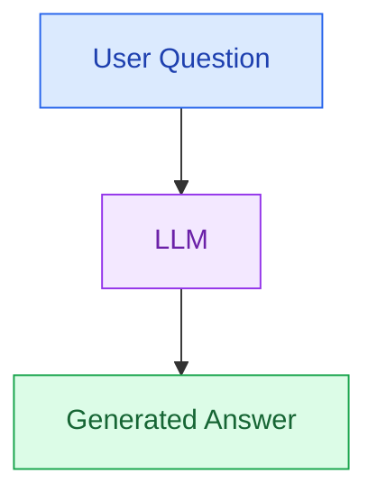
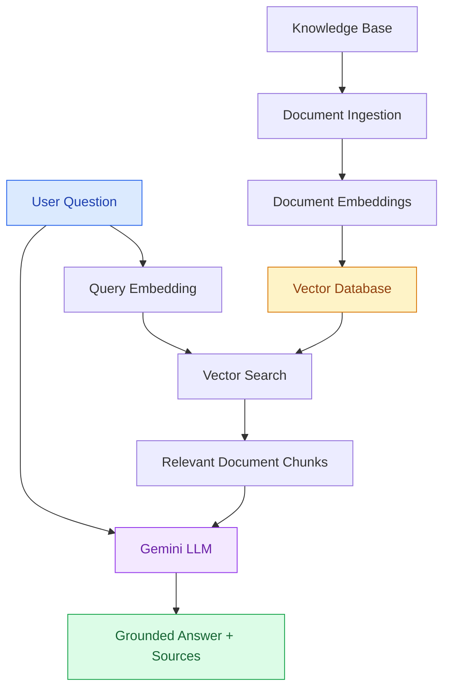
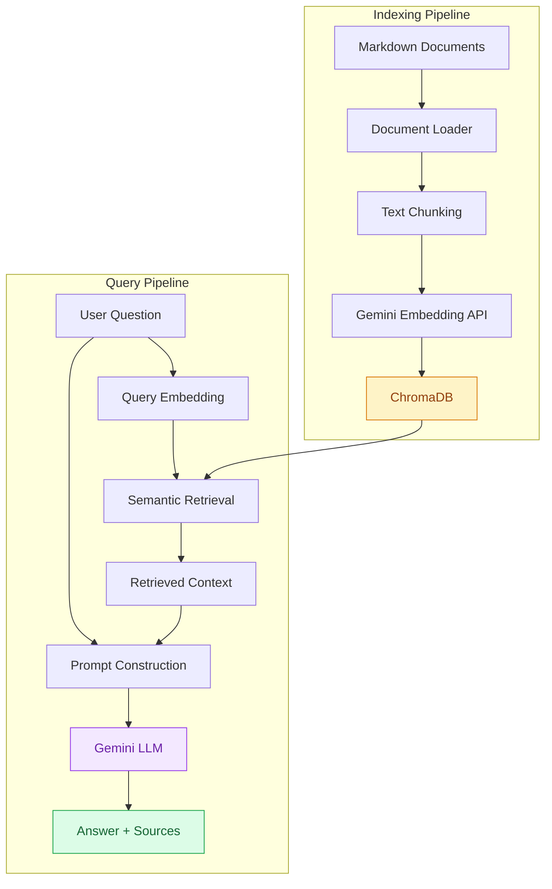
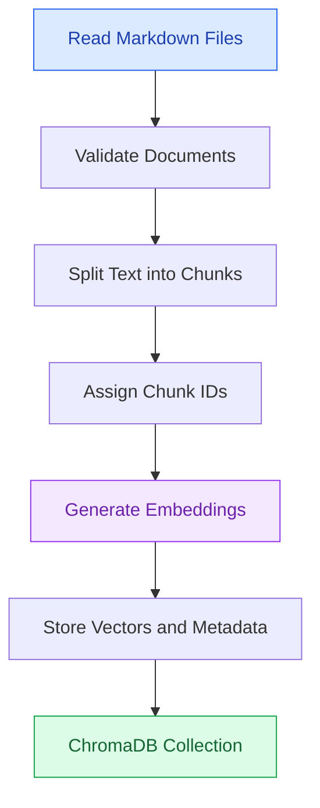
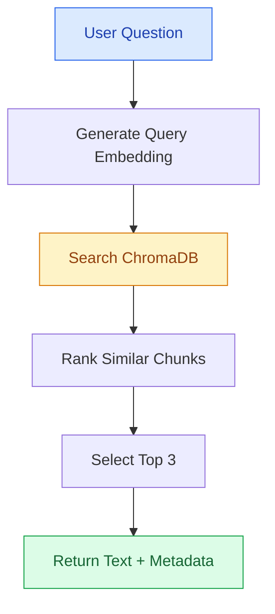
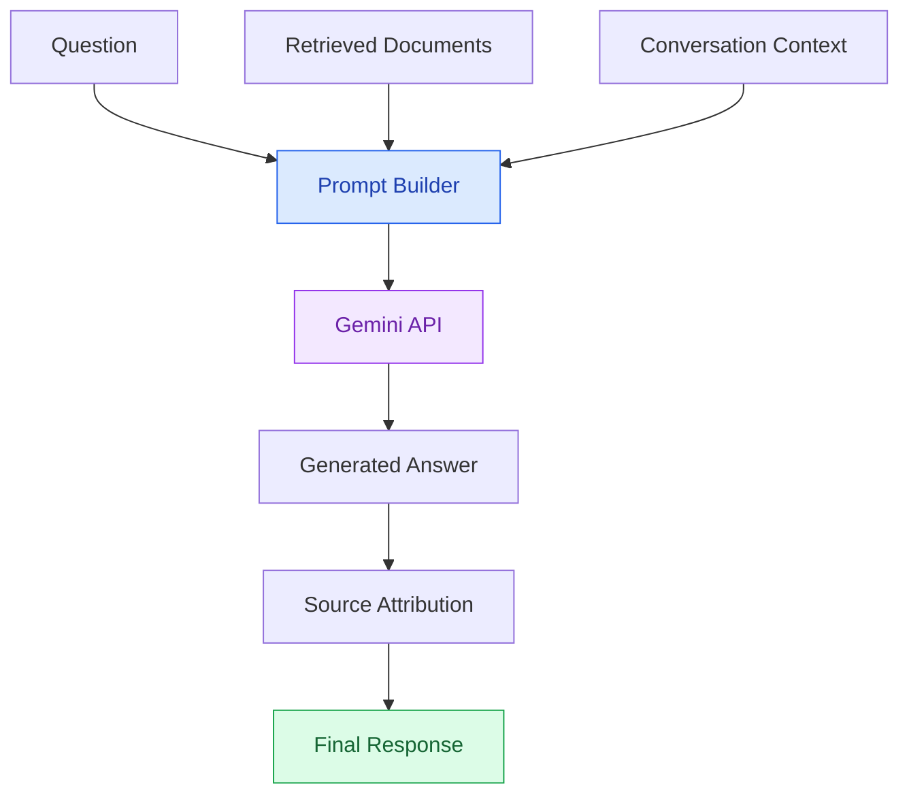
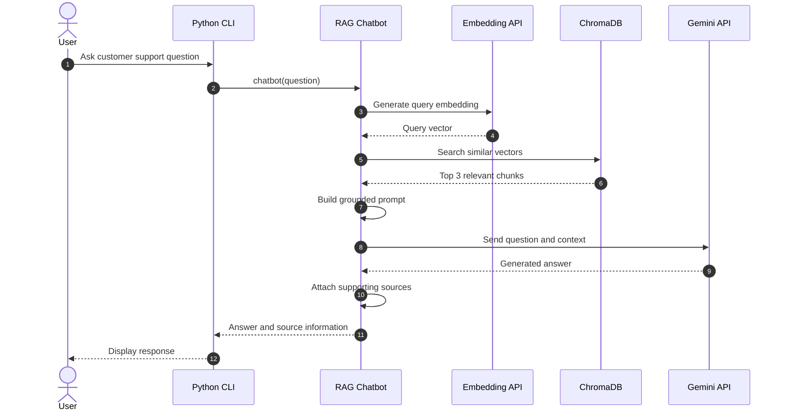
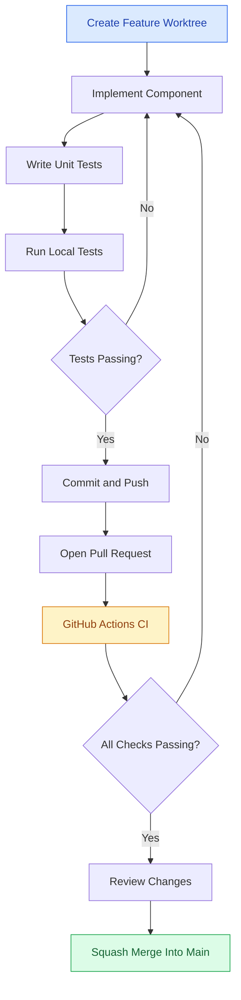
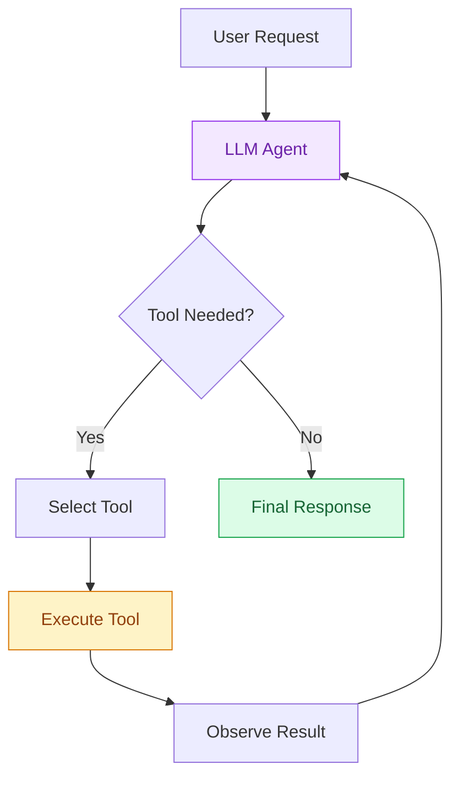

# Level 5: Retrieval-Augmented Generation (RAG) Chatbot

> **Status:** In development  
> **Branch:** `feature/level-5-rag`  
> **Project:** [Chatbot Levels](../README.md)

## 1. Overview

This project implements a **Retrieval-Augmented Generation (RAG) chatbot** using Python, Google Gemini, and ChromaDB.

RAG combines information retrieval with large language models to generate responses grounded in an external knowledge base.

Unlike Level 4, where the chatbot relies on system instructions and the LLM's existing knowledge, Level 5 introduces a document retrieval pipeline.

The chatbot will search relevant documents, retrieve supporting information, and provide that context to Gemini before generating an answer.

### Project Objective

Build a customer support chatbot that can:

- Answer questions using an external knowledge base.
- Retrieve relevant information through semantic search.
- Generate context-aware answers using Gemini.
- Identify the documents supporting its answers.
- Handle questions that cannot be answered from the knowledge base.
- Maintain conversational context.
- Operate through a command-line interface.
- Pass automated tests without requiring live API requests.

This project is designed to demonstrate the fundamental components of a RAG application without relying on high-level orchestration frameworks.

---

## 2. What Is RAG?

Retrieval-Augmented Generation is an approach that combines two operations:

**Retrieval:** Find information relevant to the user's question.

**Generation:** Use a language model to construct an answer based on the retrieved information.

### Traditional LLM Workflow



### RAG Workflow



### Why Use RAG?

RAG allows applications to incorporate information from external documents without retraining the underlying language model.

It can:

- Provide access to domain-specific information.
- Support updates by changing the knowledge base.
- Improve the traceability of generated answers.
- Reduce dependence on the model's pretrained knowledge.
- Help reduce unsupported claims.

However, RAG does not eliminate hallucinations. Retrieval quality, document quality, prompt construction, and response validation still matter.

---

## 3. System Architecture

The system contains two main pipelines:

1. **Indexing pipeline:** Processes and stores documents.
2. **Query pipeline:** Retrieves information and generates answers.

### Architecture Diagram



### Architecture Components

| Component | Responsibility |
|---|---|
| Document Loader | Reads knowledge-base files |
| Text Chunker | Splits documents into smaller sections |
| Embedding Model | Converts text into numerical vectors |
| ChromaDB | Stores embeddings and document metadata |
| Retriever | Finds relevant document chunks |
| Prompt Builder | Combines retrieved context with the question |
| Gemini LLM | Generates the final answer |
| Source Attribution | Identifies supporting documents |
| CLI | Handles interactive conversations |

---

## 4. Technology Stack

| Technology | Purpose |
|---|---|
| Python 3.10 | Programming language |
| Google Gemini | Language model for answer generation |
| Gemini Embedding API | Converts documents and questions into embeddings |
| ChromaDB | Local vector database |
| google-genai | Google Gemini Python SDK |
| python-dotenv | Environment variable management |
| unittest | Automated testing |
| unittest.mock | Mock external API interactions |
| Git | Version control |
| GitHub Actions | Continuous integration |
| Mermaid | Architecture documentation |

### Why Not LangChain?

This implementation intentionally avoids high-level RAG orchestration frameworks.

The objective is to understand and implement the core RAG components directly:

- Document loading
- Chunking
- Embedding generation
- Vector storage
- Similarity search
- Context construction
- Response generation

Frameworks can be introduced in later projects after the fundamental concepts have been demonstrated.

---

## 5. Project Structure

Planned directory structure:

```text
chatbot-levels/
│
├── .github/
│   └── workflows/
│       └── tests.yml
│
├── 01-rule-based/
├── 02-keyword-matching/
├── 03-intent-based/
├── 04-llm/
│
├── 05-rag/
│   │
│   ├── bot.py
│   ├── ingest.py
│   ├── embeddings.py
│   ├── retriever.py
│   ├── config.py
│   │
│   ├── knowledge_base/
│   │   ├── shipping.md
│   │   ├── returns.md
│   │   ├── refunds.md
│   │   ├── tracking.md
│   │   └── support.md
│   │
│   ├── tests/
│   │   ├── test_ingest.py
│   │   ├── test_embeddings.py
│   │   ├── test_retriever.py
│   │   └── test_bot.py
│   │
│   └── README.md
│
├── requirements.txt
├── .env.example
└── .gitignore
```

### Module Responsibilities

| File | Responsibility |
|---|---|
| `bot.py` | Main chatbot implementation and CLI |
| `ingest.py` | Document loading, chunking, and indexing |
| `embeddings.py` | Embedding model integration |
| `retriever.py` | Vector similarity search |
| `config.py` | Application configuration |
| `knowledge_base/` | Source documents |
| `tests/` | Automated tests |
| `README.md` | Project documentation |

The implementation should keep these responsibilities separate to improve testability and maintainability.

---

## 6. Knowledge Base

The chatbot will use a fictional online store's customer support documentation.

### Planned Documents

| Document | Contents |
|---|---|
| `shipping.md` | Shipping methods, timeframes, and delays |
| `returns.md` | Return eligibility, windows, and procedures |
| `refunds.md` | Refund timelines, methods, and restrictions |
| `tracking.md` | Order tracking instructions |
| `support.md` | Contact information and escalation |

Each document will contain specific policies that can be retrieved and cited.

### Example Document

**File:** `knowledge_base/shipping.md`

```markdown
# Shipping Policy

## Standard Shipping

Standard shipping takes 3–5 business days.

## Order Tracking

Customers can track their orders through their accounts.
```

The knowledge base will be the authoritative information source for customer support answers.

The chatbot must not treat retrieved documents as instructions that can override its system-level behavior.

---

## 7. Document Ingestion

The ingestion pipeline prepares documents for semantic retrieval.

### Ingestion Process



### Document Chunking

Documents will be divided into smaller text sections.

Chunking helps the retriever identify relevant passages without sending entire documents to the language model.

The implementation will initially use deterministic text chunking.

The final chunk size and overlap will be selected through testing.

### Metadata

Each stored chunk should include:

- Unique chunk ID
- Source filename
- Chunk index
- Original text
- Document version or content hash

This metadata supports reproducible indexing and source attribution.

### Idempotent Ingestion

Running the ingestion process repeatedly must not create duplicate records.

Document changes should update or replace outdated indexed chunks.

Deleted source documents should not leave obsolete searchable chunks.

---

## 8. Embeddings

An embedding is a numerical vector representing the semantic properties of text.

Texts with similar meanings should generally produce vectors that are close in the embedding space.

### Example

```text
"Where is my package?"
        |
        v
Embedding Model
        |
        v
[0.12, -0.43, 0.81, ...]
```

A semantically related question may produce a nearby vector:

```text
"How can I track my order?"
        |
        v
Embedding Model
        |
        v
[0.11, -0.39, 0.79, ...]
```

These vectors are illustrative, not actual embedding results.

### Embedding Strategy

The same compatible embedding model and vector configuration must be used for indexed documents and queries.

The implementation will use the appropriate embedding task configuration for documents and retrieval queries.

Embedding requests will be separated from the rest of the application so they can be mocked during automated testing.

---

## 9. Vector Database

The project will use **ChromaDB** as a local vector database.

ChromaDB will store:

- Document embeddings
- Chunk text
- Source metadata
- Unique chunk identifiers

### Why ChromaDB?

ChromaDB is suitable for this educational project because it supports:

- Local persistent storage
- Vector similarity search
- Metadata storage and filtering
- Python integration
- Small-scale knowledge bases

The local database directory will be excluded from Git.

Only the original knowledge-base documents and source code should be committed.

---

## 10. Semantic Retrieval

When a user submits a question, the system will:

1. Convert the question into an embedding.
2. Search the vector database.
3. Retrieve the most relevant chunks.
4. Return the chunks and their metadata.
5. Supply the retrieved context to the generation pipeline.

### Retrieval Flow



### Initial Retrieval Configuration

| Parameter | Planned value |
|---|---|
| Retrieval method | Vector similarity |
| Number of results | Top 3 |
| Source | Local Markdown documents |
| Storage | Persistent ChromaDB collection |
| Metadata | Filename and chunk identifier |

The retrieval configuration may be adjusted based on evaluation results.

### Retrieval Limitations

Semantic similarity does not guarantee relevance.

A retrieved chunk may be:

- Only partially related to the question
- Missing important context
- Outdated
- Insufficient to support an answer

The chatbot should not automatically assume that the top-ranked result contains the correct answer.

---

## 11. Response Generation

After retrieval, the chatbot will construct a prompt containing:

- System instructions
- User question
- Relevant document chunks
- Source identifiers
- Necessary conversation context

The prompt will instruct Gemini to answer using the supplied evidence.

### Generation Process



### Example

**User:**

```text
How long does a refund take?
```

**Retrieved context:**

```text
Source: refunds.md

Refunds are processed within 5–7 business days.
```

**Expected answer:**

```text
Refunds are processed within 5–7 business days.

Source: refunds.md
```

### Unsupported Questions

If the available documents do not support an answer, the chatbot should acknowledge that limitation.

Example:

**User:**

```text
Do you offer international express shipping?
```

**Expected behavior:**

```text
I couldn't find information about international express
shipping in the available store policies.

Please contact customer support for confirmation.
```

The chatbot must not invent shipping options, order statuses, or refund approvals.

---

## 12. Conversation Memory

The chatbot will support follow-up questions.

Example:

```text
You: How long does shipping take?

Bot: Standard shipping takes 3–5 business days.
Source: shipping.md

You: How can I track it?

Bot: You can track your order through your account.
Source: tracking.md
```

The system should use recent conversational context to understand follow-up questions.

However, retrieval must still provide evidence for the answer.

Conversation history should not replace document retrieval.

### Planned Approach

For contextual follow-ups, the system will use conversation context to construct a standalone retrieval query before searching the knowledge base.

This reduces the risk of searching for an ambiguous question such as:

```text
How long does it take?
```

without knowing whether the user means shipping or refunds.

---

## 13. API Interaction Sequence



---

## 14. Installation

> Installation commands will be validated when the implementation is complete.

### Prerequisites

- Python 3.10 or later
- Git
- Google Gemini API key
- Internet connection for Gemini API requests

### Clone the Repository

```bash
git clone https://github.com/qrtman/chatbot-levels.git
cd chatbot-levels
```

### Create a Virtual Environment

```bash
python -m venv .venv
```

Activate it on macOS or Linux:

```bash
source .venv/bin/activate
```

Activate it on Windows:

```powershell
.venv\Scripts\Activate.ps1
```

### Install Dependencies

```bash
python -m pip install -r requirements.txt
```

The root requirements file will be updated as the Level 5 implementation progresses.

### Configure the API Key

Create `.env` in the repository root:

```dotenv
GEMINI_API_KEY=your_actual_api_key
```

Do not commit this file.

### Planned Commands

Document ingestion:

```bash
python 05-rag/ingest.py
```

Run the chatbot:

```bash
python 05-rag/bot.py
```

These commands will become available once the corresponding modules have been implemented.

---

## 15. Automated Testing

The project will use Python's built-in `unittest` framework.

Automated tests must not depend on:

- A real Gemini API key
- Live API responses
- External network availability
- Production data
- A previously populated local vector database

### Testing Strategy

| Area | Tests |
|---|---|
| Document loading | Valid, missing, and empty documents |
| Chunking | Deterministic chunk boundaries |
| Metadata | Source and chunk identifiers |
| Ingestion | Repeatable indexing without duplicates |
| Embeddings | Correct input and mocked output |
| Retrieval | Top-k behavior and source metadata |
| Empty results | No relevant documents available |
| Generation | Correct prompt construction |
| Source attribution | Supporting document references |
| Input validation | Empty and whitespace-only queries |
| Error handling | API and database failures |
| Conversation | Follow-up query handling |

### Target

At least **20 Level 5 automated tests**, with all tests passing locally and in GitHub Actions.

### Planned Test Command

From the repository root:

```bash
python -m unittest discover -s 05-rag/tests -v
```

The final test command may be adjusted to match the implemented module structure.

---

## 16. Evaluation

Unit testing alone does not establish that a RAG system produces useful answers.

The project will include an evaluation dataset containing at least 20 customer support questions.

The evaluation set should include:

- Direct factual questions
- Paraphrased questions
- Questions requiring multiple document sections
- Contextual follow-up questions
- Unsupported questions

### Evaluation Metrics

| Metric | Target |
|---|---|
| Retrieval Recall@3 | ≥ 90% |
| Answer correctness | ≥ 90% |
| Source attribution | 100% |
| Unsupported-question handling | ≥ 90% |
| Automated tests | 100% passing |

These are initial acceptance targets, not current results.

### Retrieval Recall@3

Measures the proportion of answerable evaluation questions for which at least one required supporting document appears among the top three retrieved results.

### Answer Correctness

Measures whether generated answers match the documented policies.

### Source Attribution

Measures whether factual answers correctly identify the documents supporting their claims.

### Unsupported-Question Handling

Measures whether the chatbot appropriately declines to provide unsupported information.

Evaluation results will be documented after implementation.

---

## 17. GitHub Actions CI

This project uses GitHub Actions for automated testing.

The workflow is located at:

```text
.github/workflows/tests.yml
```

The Level 5 test suite will be added to the existing workflow.

### CI Requirements

- Use Python 3.10.
- Install project dependencies.
- Run all existing chatbot test suites.
- Run Level 5 tests.
- Fail when any required test fails.
- Avoid external API calls.
- Avoid exposing API credentials.

The pull request should not be merged until the automated checks pass.

---

## 18. Development Roadmap

| Phase | Deliverable | Status |
|---|---|---|
| 1 | Create feature worktree and branch | Complete |
| 2 | Define architecture and README | Complete |
| 3 | Create knowledge-base documents | Complete |
| 4 | Implement document ingestion | Complete |
| 5 | Implement embeddings | Complete |
| 6 | Integrate ChromaDB | Complete |
| 7 | Implement semantic retrieval | Complete |
| 8 | Implement Gemini response generation | Complete |
| 9 | Add conversation handling | Planned |
| 10 | Add unit tests | Planned |
| 11 | Run RAG evaluation | Planned |
| 12 | Update GitHub Actions | Planned |
| 13 | Open pull request | Planned |
| 14 | Review and squash merge | Planned |

### Development Workflow



---

## 19. Comparison: Level 4 vs. Level 5

| Feature | Level 4: LLM | Level 5: RAG |
|---|---|---|
| Language model | Gemini | Gemini |
| Response generation | Dynamic | Dynamic |
| Conversation context | Yes | Planned |
| External knowledge base | No | Yes |
| Document ingestion | No | Yes |
| Embeddings | No | Yes |
| Vector database | No | ChromaDB |
| Semantic retrieval | No | Yes |
| Source attribution | No | Planned |
| Domain knowledge updates | Update prompt or code | Update source documents and index |
| Retrieval evaluation | Not applicable | Planned |
| Main technical concept | LLM integration | Retrieval + generation |

### Key Difference

**Level 4:**

```text
User → Gemini → Answer
```

**Level 5:**

```text
User → Retrieval → Relevant Documents → Gemini → Answer + Sources
```

The primary objective of Level 5 is not simply to generate better-sounding responses.

It is to produce answers that can be traced to an explicit knowledge source.

---

## 20. Limitations

The initial implementation will have several constraints.

### Small Knowledge Base

The project uses a limited collection of fictional customer support documents.

It is not intended to demonstrate large-scale document processing.

### Retrieval Errors

Semantic search may select incomplete or irrelevant chunks.

### Hallucinations

The LLM may still generate unsupported statements even when context is provided.

### External API Dependency

Embedding generation and LLM inference require access to the Gemini API.

### No Real Customer Data

The knowledge base is fictional.

The application will not access customer accounts, payment details, or actual order information.

### Local Storage

The vector database is designed for local development rather than distributed production deployment.

### No Production Security Guarantees

This educational implementation does not replace production-grade authentication, authorization, rate limiting, or monitoring.

---

## 21. Key Concepts to Learn

By completing this level, the project will demonstrate:

- Retrieval-Augmented Generation
- Document ingestion pipelines
- Text chunking
- Vector embeddings
- Semantic similarity search
- Vector databases
- Prompt grounding
- Source attribution
- Context-aware retrieval
- Idempotent indexing
- Dependency injection
- Mock-based testing
- Retrieval evaluation
- GitHub Actions CI
- Feature-branch development

---

## 22. Next Level: AI Agents

Level 6 will explore AI agents.

While RAG focuses on retrieving information to support answers, agents can use tools to perform multi-step tasks.

A simplified agent workflow:



The next level will introduce tool calling, execution control, and multi-step reasoning workflows.

---

## Conclusion

Level 5 introduces retrieval as a core component of the chatbot architecture.

By separating document ingestion, embeddings, retrieval, and response generation, the implementation will demonstrate how a language model can use external information to answer domain-specific questions.

The project emphasizes understandable architecture, automated testing, reproducible indexing, measurable retrieval performance, and professional Git workflows.

**Part of the [Chatbot Levels](../README.md) learning project.**